# Sirkit

Sirkit is digital design you can build, run and see inside. Draw a circuit and its wires
change colour as their values change. Clock a counter and its waveform grows under the
canvas, every edge a few nanoseconds late because every gate takes its time. Circle a group
on a K-map and it is checked as you let go. Write a module in Verilog and see it drawn as
gates.

I have taught digital design for years, and the trouble is never the symbols. A student can
draw an AND gate and write a truth table on the first day. What stays abstract is everything
that happens between the inputs and the outputs: why a K-map group that looks fine is not
prime, why the master–slave flip-flop changes only at the edge, why the ripple adder is slow,
why a glitch appears on a wire that "should" stay at 1, what a non-blocking assignment
actually waits for. On a whiteboard all of this is a static picture and a lot of hand waving.
In a real lab the wires do not tell you their values. Sirkit simulates every wire with real
delays and shows you each step, on circuits and functions you choose.

Live at https://sirkit.jyotiprakash.org

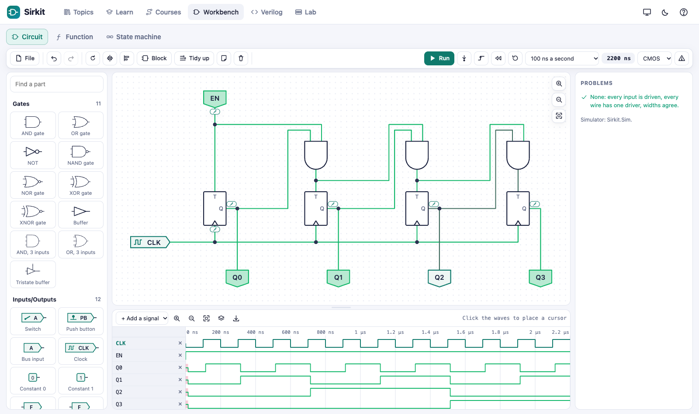

## What it is

Sirkit is one HTML file. There is nothing to install and nothing is sent anywhere; your
circuits, answers and progress are kept in the browser. Under the page are engines written
for it: a Boolean algebra engine that parses, proves, minimises by map and by tabulation and
finds hazards; an event-driven logic simulator with four-valued wires, gate delays, setup and
hold checks and static timing; a schematic layout engine that draws any circuit it is given;
a Verilog compiler, simulator and synthesiser; state-machine design from diagram to gates;
switch-level CMOS; and a small processor that runs programs on its own datapath. Every
picture is drawn from what those engines do on your input.

There are 200 topics in 50 families, 153 lessons, 540 exercises and 15 lab experiments,
in fourteen parts:

- **Numbers and codes** (16 topics): bases and conversion, fractions, complements and signed
  numbers, BCD, Gray, parity and Hamming codes, and binary storage.
- **Boolean algebra and gates** (17): the two-valued algebra and its theorems, duality,
  algebraic simplification, expressions, truth tables and canonical forms, and the gates in
  both the distinctive and the rectangular style.
- **Minimisation** (21): K-maps from two to six variables, prime and essential implicants,
  cyclic maps, don't-cares, product of sums, several outputs, map-entered variables, the
  Quine–McCluskey tabulation, the prime implicant chart and Petrick's method, NAND and NOR
  forms, bubble pushing, XOR forms and static hazards.
- **Combinational logic** (23): analysis and design, code converters, half and full adders,
  ripple carry and carry lookahead, multipliers, comparators, decoders, encoders,
  multiplexers, demultiplexers and buses.
- **Storage** (18): latches and their forbidden input, flip-flops of every kind, the
  master–slave hand-over, setup, hold, clock skew, the minimum clock period and
  metastability.
- **State machines** (14): Mealy and Moore machines, analysis, state reduction, state
  assignment, design with D, JK and T flip-flops, and machines at work.
- **Registers and counters** (13): registers with load, shift registers, ripple and
  synchronous counters, up/down counters, ring and Johnson counters, and lock-out.
- **Memory and programmable logic** (12): RAM and ROM, error-correcting memory, PLA, PAL and
  a tiny FPGA that is mapped, placed, routed and run.
- **Register-transfer design** (11): ASM charts, what one clock edge does, datapath and
  controller, and worked designs: a multiplier, a divider, a GCD engine, a traffic light and
  a vending controller.
- **Asynchronous circuits** (12): flow tables, races and cycles, race-free assignment and
  hazards.
- **Digital integrated circuits** (13): noise margins, fan-out and the parameters of a
  family, TTL and CMOS output stages, the CMOS transfer curve, and gates built from
  switches.
- **Verilog** (22): structure and dataflow, behavioural code, parameters, generate and
  hierarchy, state machines in Verilog, testbenches, the scheduler and synthesis.
- **A small processor** (8): an instruction set, a bus and datapath, hard-wired and
  microprogrammed control, and programs that run on it.
- **Lab bench**: a breadboard with 74-series chips, which has its own page (below) and 15
  experiments spread through the other parts.

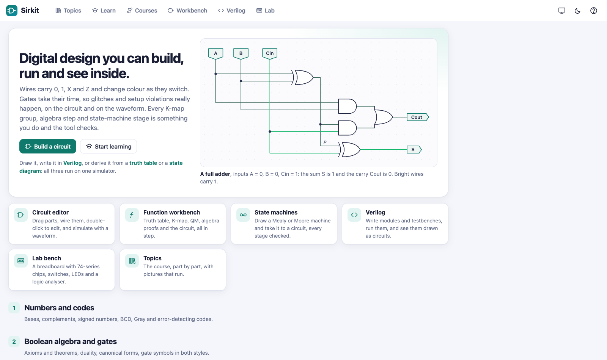

## Building circuits

The **circuit editor** is where students build things of their own. The palette on the left
has the parts in their categories: gates (with two or three inputs, and a tristate buffer),
switches, push buttons, bus inputs, a clock, constants, outputs, pull-ups and pull-downs,
multiplexers, decoders, encoders, bus splitters and mergers, adders, an adder–subtractor, a
comparator, a multiplier and an ALU, flip-flops and latches of every kind, registers, shift
registers and counters, ROM and RAM, LEDs, seven-segment and hex displays, probes, and 19
74-series chips. In all there are 49 kinds of part besides the chips. Drag one onto the
canvas, draw wires from pin to pin, double-click a part to set its parameters (its width, its
number of inputs, its delay, the contents of a ROM in a hex editor), select a few parts and
press B to make them a block that can be used again and opened. Tidy up hands the circuit to
the layout engine, which redraws it with no wire through a part. Everything can be undone.

Run starts the simulation. Each wire carries 0, 1, X (unknown) or Z (floating), per bit, and
takes the colour of its value; a click on a switch flips it while the circuit runs. The
simulation can go one event at a time, to the next clock edge, or at a speed you choose, and
can be rewound. The **problems** list says what is wrong with a circuit before it runs: an
input nothing drives, a wire with two drivers, widths that do not agree.

The **waveform viewer** is docked under the canvas. Signals are added by name or by pressing
W on a wire, reordered by dragging and gathered into groups; a bus shows its value in binary,
hex, decimal or signed. Two cursors give the values at each and the time between them. Pulses
narrower than a threshold are marked as glitches, and setup and hold violations are marked
with a sentence saying what went wrong. The waves export as VCD, SVG or PNG.

Timing is real. Every part has a delay taken from the **technology** you choose: CMOS
(74HC-like), TTL, LS-TTL or FPGA-like, each with its own gate delays, setup and hold times and
clock-to-output delays, and every part can override them. A flip-flop whose setup time is
violated goes metastable for a while. Settings choose what a floating input reads (as TTL or
as CMOS does) and what storage holds at power-up (0, X or random). A circuit is saved as a
file, exported as a picture or as structural Verilog, or shared as a link.

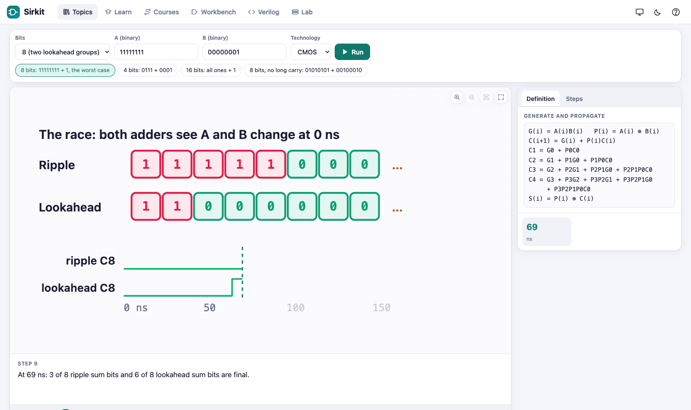

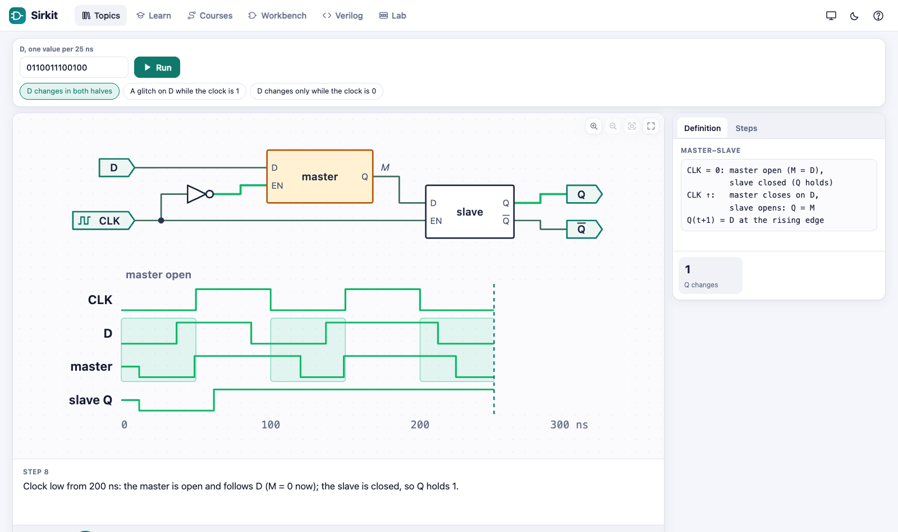

## The function workbench

The **function workbench** holds one Boolean function and keeps every view of it in step. On
the left is its truth table, where a click cycles an output through 0, 1 and don't-care.
Above are the expression in your own notation (A'B + C, A̅·B + C or ~A & B | C), the Σm list
with its don't-cares, and the ΠM list. Change any of them and the others follow. Under them
are eight tabs.

The **K-map** tab draws the map for one to six variables in Gray order, five as two maps side
by side and six as four in a square. You circle a group by pressing on a cell and dragging to
the opposite corner; dragging past an edge wraps round, so the four corners make one group.
Each group is checked as you draw it: is it a rectangle of a power of two, does it hold only
1s and don't-cares, is it prime. Then Check my cover judges the whole cover. A cover that
leaves a 1 out says which. A cover that is correct but not minimal says so, how many terms and
literals it has against the minimum, which of your groups can be made bigger, and draws a
smaller cover dashed over the map. The same works for the 0s and a product of sums.

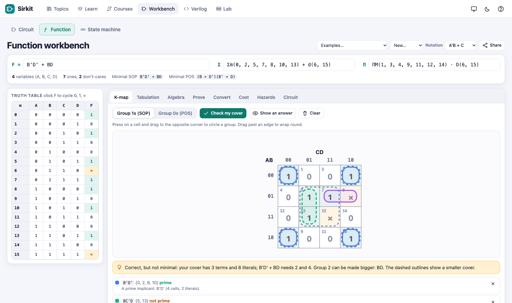

The **Tabulation** tab runs Quine–McCluskey: the columns of terms grouped by their number of
1s, each merge ticked, the prime implicants starred, the prime implicant chart with the
essential rows shaded, and the steps of choosing a cover in words.

The **Algebra** tab is a proof game. You give a start and a goal, or leave the goal empty to
mean as few literals as possible. Click any part of the expression to select it, then click
a law: identity, null element, idempotence, involution, complement, commutative,
associative, both distributive laws, absorption in both forms, De Morgan, consensus,
uniting, a redundant term, and seven laws of XOR. The law rewrites the part you selected, or
refuses and says why it does not apply there. A hint looks one or two moves ahead and selects
the part to work on. Steps can be undone, replayed one at a time, and exported.

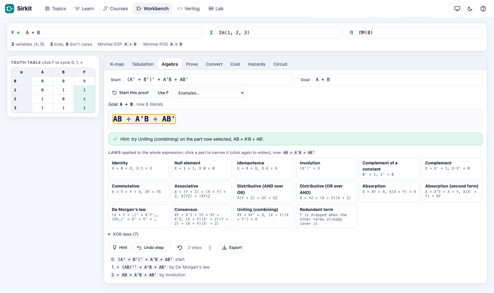

The other tabs: **Prove** compares any two expressions on every row and shows a row where
they differ, or checks a theorem and its dual. **Convert** gives the canonical and minimal
SOP and POS, the complement and the dual, and the steps from Σm to ΠM. **Cost** builds the
function in each style (as written, AND-OR, NAND-NAND, OR-AND, NOR-NOR and more) and counts
gates, inverters, gate inputs, levels and the worst delay. **Hazards** finds the static-1 or
static-0 hazards in a cover, marks them on the map, and gives the cover with the consensus
terms that remove them.
**Circuit** draws the function as a circuit in any of seven styles, NAND-only and NOR-only
multi-level among them, and opens it in the circuit editor to simulate.

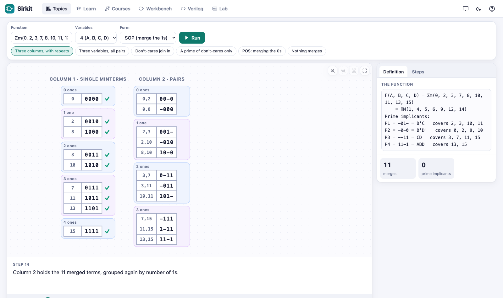

## State machines

The **state-machine workbench** starts from a state diagram. Double-click for a state, drag
from its rim to another state for an arrow, and label it input/output for a Mealy machine or
give each state its output for a Moore machine. The diagram can also be edited as text. The
machine runs on any input sequence, one clock at a time, with the state it is in and the
arrow it just took lit on the diagram and a sentence for each clock.

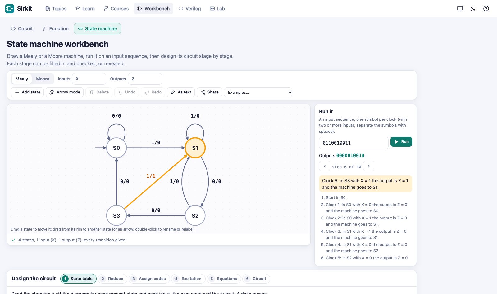

Then the design, in six stages: the state table; the reduced table, by the implication table
or by partition refinement; a state assignment (binary, Gray, one-hot, by adjacency or your
own codes) with the cost of each; the excitation table for D, JK, T or SR flip-flops; a K-map
and a minimal equation for each flip-flop input and each output; and the circuit. At every
stage you fill in the answer and it is checked, or you ask for it to be revealed. The circuit
is checked against the table from every state and input, the unused states are followed to
see where they lead, and the whole design opens in the circuit editor to simulate.

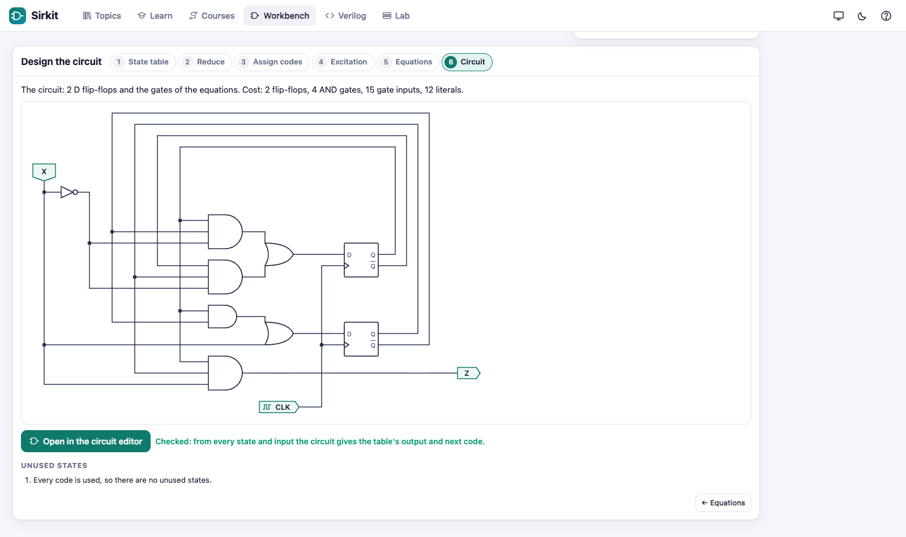

The register-transfer part takes the same idea further with ASM charts, where the state box,
the decision and the register transfers are lit on each clock and the registers change
beside them.

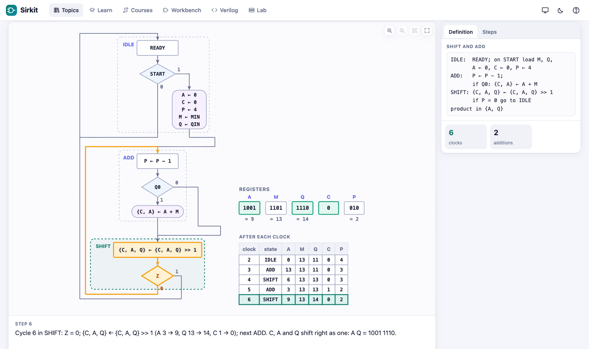

## Verilog

The **Verilog** page has files in tabs and an editor with highlighting, line numbers and
errors marked as you type, with the line and column. Run elaborates the top module and
simulates it: what `$display` and `$monitor` print appears in the console, and the signals in
the waveform viewer. Synthesise turns a module into gates, flip-flops, multiplexers and
adders, drawn by the layout engine as blocks or as gates, and opens it in the circuit editor;
code that cannot be built gives the reason with the line. The other way round, any circuit in
the editor exports as structural Verilog. There are six example projects; files open and save
as `.v`, the waveforms save as `.vcd`, and a project can be shared as a link.

The simulator schedules events the way the language says, with active, inactive,
non-blocking and postponed regions, so the races that come from using `=` where `<=` is meant
really happen. Its output is tested against Icarus Verilog on a corpus of 210 programs.

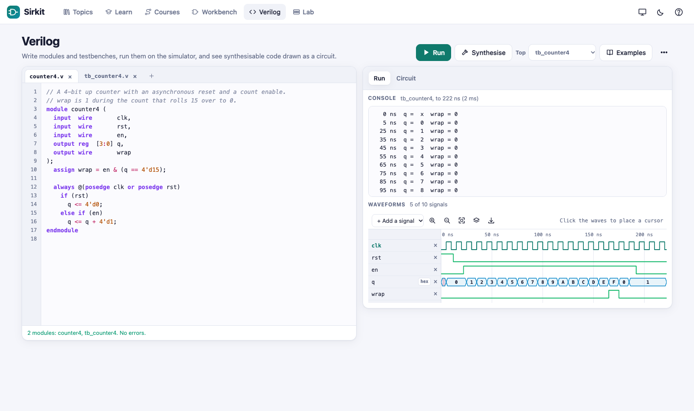

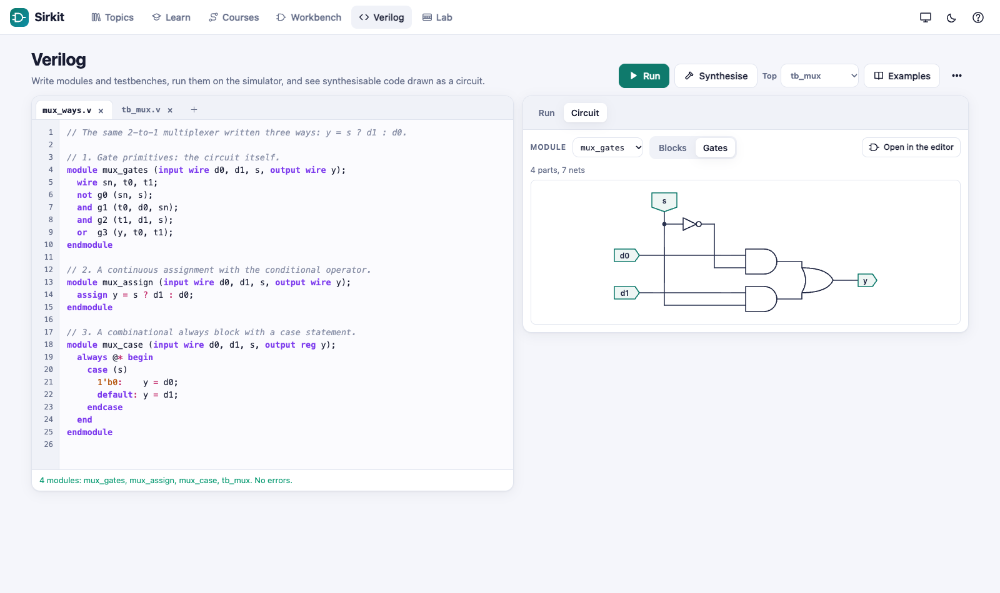

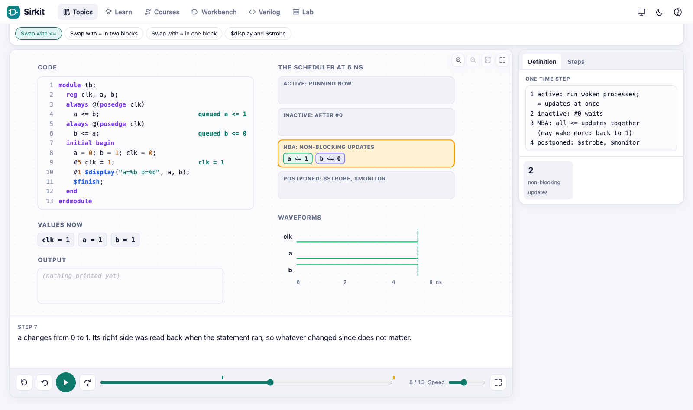

## The lab bench

The **lab bench** is a breadboard on a logic trainer. Above the board are eight LEDs, a
seven-segment display, a logic probe and the eight channels of a logic analyser; below it
eight switches, two push buttons (which can be set to bounce), a clock generator and the
supply. There are 17 chips to place: the 7400, 7402, 7404, 7408, 7432 and 7486 gates, the
7474 and 7476 flip-flops, the 74138 decoder, the 74151 and 74153 multiplexers, the 74161 and
74163 counters, the 74194 shift register, the 74283 adder, the 7447 display driver and the
7485 comparator. A chip has to be powered, and an input left open reads 1 on TTL and floats
on CMOS, as on a real bench. Under "What the bench sees" it says in plain sentences what is
wrong: a chip without power, an open input, two outputs that fight.

The 15 experiments open beside the bench with their aim, the chips they need, the steps, an
observation table to fill in from the board, and a button that checks the wiring.

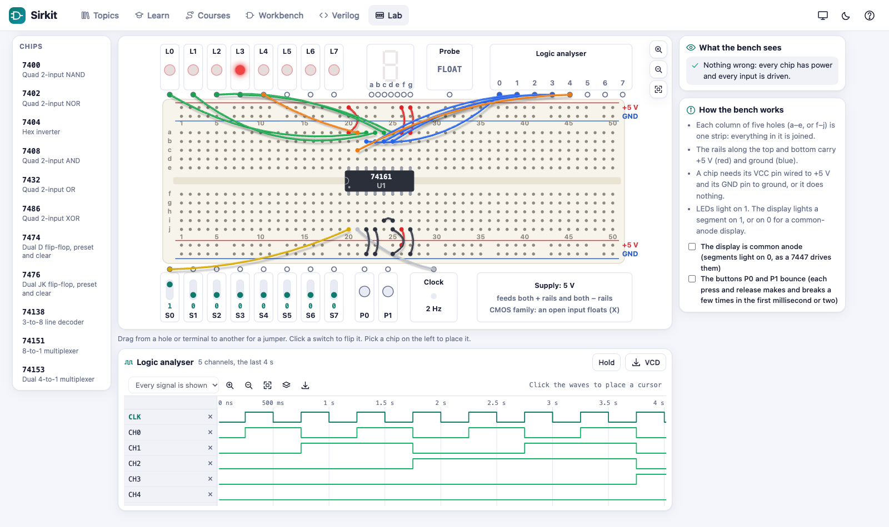

## Watching a topic

Every topic has its own picture, made for that idea. The stage is in the middle. Play runs the
steps at the speed you set; the arrow keys go one step forward or back; the timeline jumps
anywhere. Under the stage the narration explains the step with the actual values: "Clock low
from 200 ns: the master is open and follows D (M = 0 now); the slave is closed, so Q holds 1."
On the right is
the definition, the equations or the table the topic follows, and under it the counters:
edges, merges, clocks, nanoseconds, switches on. The Steps tab lists every step, to jump to
any of them.

Above the stage you give the input: an expression, a list of minterms, two numbers to add, a
bit pattern for D, a Verilog testbench, a program. Each topic has presets for the cases that
matter, 828 of them across the catalogue. At the key moments a topic stops and asks you to
predict what happens next before it shows you; predictions can be turned off with P. Every
topic ends with a quiz, 816 questions in all. Share copies a link to the topic with your
input.

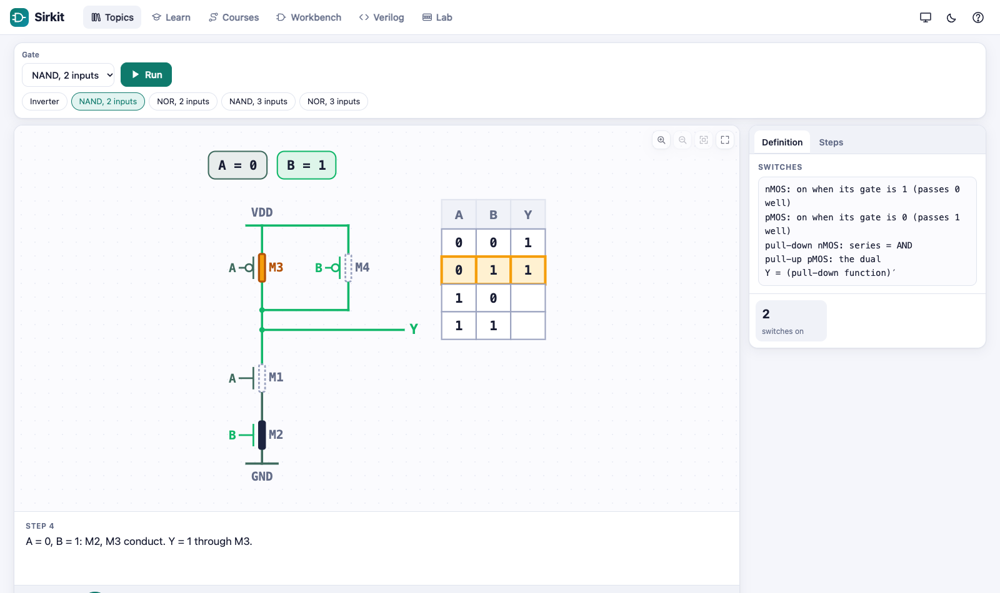

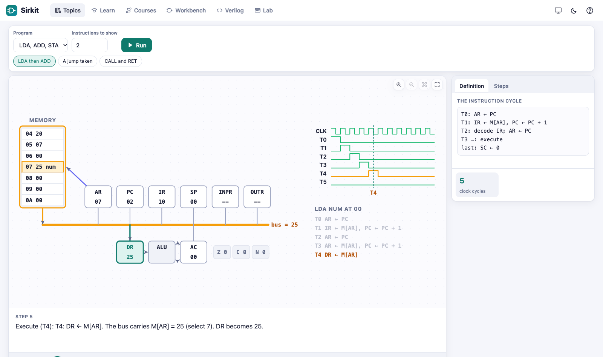

## Lessons, exercises, labs, tours and courses

The **Learn** page has 153 lessons in 43 chapters. A lesson explains one idea with topics
running inside it, live circuits whose switches you can click, K-maps, waveforms, Verilog
that runs, and questions to answer before reading on.

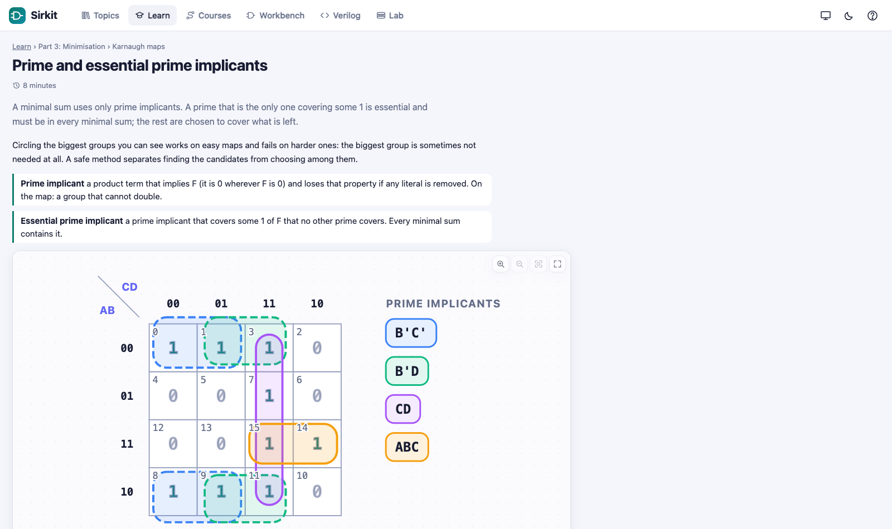

There are 540 exercises: 77 to choose an answer, 68 circuits to build, 65 numbers and 26
strings to work out, 43 Verilog modules, 40 conversions, 35 K-maps to cover, 28 state-machine
designs, 32 waveforms to draw and 22 timing questions, 19 algebra proofs and 11
simplifications, 15 expressions, 15 lab experiments to wire and observe, 11 programs for the
processor, 11 sets, 16 tables and truth tables to fill in, and 6 Quine–McCluskey charts. An
answer is checked, not compared as text. A circuit is simulated on every input row, or on
every input sequence up to a length for sequential circuits, and if it is wrong the checker
gives the first row where it differs, with buttons to show those inputs on your circuit and
to open the run in the workbench. A Verilog module runs against a hidden testbench, a program
runs on test inputs. Each exercise has three hints, the last one the worked answer.

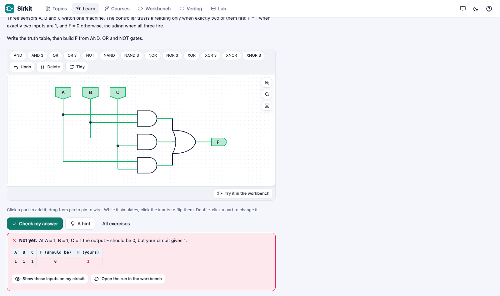

The 13 **tours** walk through a part, pointing at one thing at a time, for a first look
round. The 13 **courses** put the topics, lessons and exercises of a part in an order that
builds up, with a line on what to look for in each, and keep your progress.

## Phone, projector and themes

There is a light and a dark theme, and the first visit follows the system setting. Projector
mode (Shift+P) makes the type larger and the lines heavier, for a classroom wall. Gate
symbols can be drawn in the distinctive shapes or in the rectangular style with &, ≥1 and =1.
On a phone the stage comes first with the narration under it, the inputs follow, and the
definition and the steps open in a drawer from the bottom.

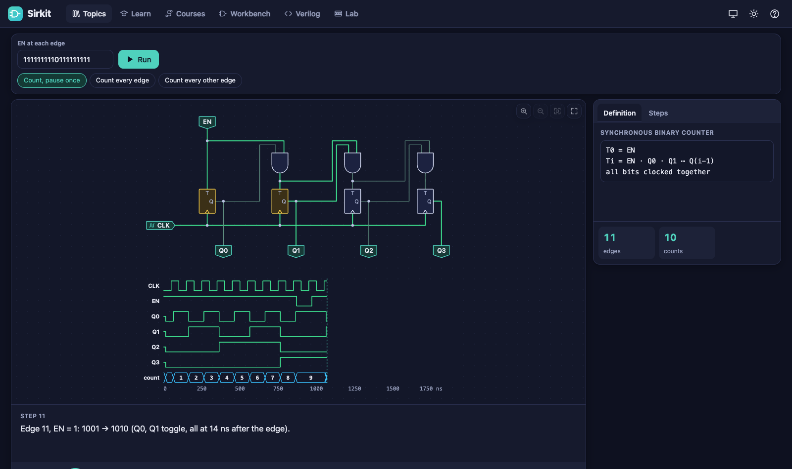

<p>
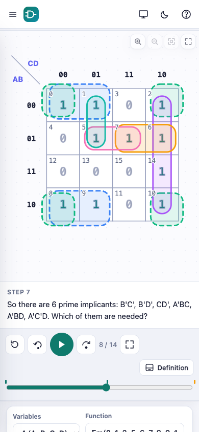
</p>

## Keyboard

| Key | Does |
| --- | --- |
| Space | play or pause a topic |
| → ← | next step, step back |
| Home, End | first or last step |
| [ ] | slower, faster |
| F, Shift+F | fit the picture, the stage on the whole screen |
| P, Q | predictions on or off, the quiz |
| Enter | run or pause the circuit |
| . | one simulation event |
| E | to the next clock edge |
| Backspace | rewind the simulation |
| W | probe the selected wire |
| R, M | turn a part a quarter, mirror it |
| B, L | make a block of the selection, label the selected wire |
| Ctrl+Z, Ctrl+Y | undo, redo |
| Ctrl+Enter | run the Verilog top module |
| 1 … 8 | the tabs of the function workbench |
| H | a hint in the proof game |
| 0 … 7 | flip switch S0 … S7 on the lab bench |
| T, Shift+P | light or dark, projector mode |
| ? | the list of keys |

## Running it locally

Sirkit is the single file `index.html`. Open it from any web server:

```
python3 -m http.server 8000
```

and go to http://localhost:8000. To change it, edit the files under `src` and run

```
node build.mjs
```

which joins the sources listed in `src/manifest.json` into `index.html`. While working,
`node tools/devpage.mjs 8080` serves http://127.0.0.1:8080/dev.html, the same page with every
source file loaded on its own, so a change needs no build.

## Testing

The engines are tested on their own in Node: `node tests/bool.mjs`, and likewise `sim`,
`layout`, `fsm`, `cmos`, `cpu` and `vlog`. Most of these compare an engine with a brute-force
oracle on seeded random inputs: a minimised function must equal the original on every row and
no smaller cover may exist, every law of the proof game must preserve the function, every
part of the simulator must match its truth table or a reference model, every drawing of the
layout engine must keep its geometric rules, and a state machine's circuit must behave like
its table. `tests/vlog.mjs` runs the corpus in `tests/vlog` and requires exactly what Icarus
Verilog printed and the same VCD values, and simulates every synthesised netlist against the
behavioural code.

`node tests/topics-claims.mjs` and `node tests/topics-timing.mjs` run the topics with every
preset and check that each value the narration quotes is what the engine and the drawing have
at that step. `node tools/check-topics.mjs` runs every topic with its default input and every
preset, and checks that every frame draws, that the steps are narrated, that the predictions
can be answered, and that the topic has a quiz. `node tools/check-content.mjs` checks every
exercise (its solution passes its own checker and every one of its wrong answers fails),
every lesson, every lab's checks on its reference wiring, and every tour and course step.

`node tools/check-diagrams.mjs` draws the layout gallery and every page and topic in the
built page, in both themes and at desktop and phone sizes, and reports shapes that overlap,
wires that run through parts, labels that collide or are cut off, and pages wider than the
screen. `node tests/e2e/run.mjs` runs the end to end tests in headless Chrome: the shell, the
circuit editor, the function and state-machine workbenches, Verilog, the lab bench, lessons
and exercises. `node tools/readme-shots.mjs` makes the pictures in this file.

## Project layout

```
src/core       the engines: Boolean algebra and minimisation, the simulator, parts, chips and technologies,
               Verilog, state machines, ASM charts, asynchronous circuits, switch-level CMOS, the processor
src/schematic  the layout engine that draws circuits: symbols, placement, routing, verification, rendering
src/stage      the stage that draws and animates a frame, and its drawing kits (K-maps, waveforms, tables,
               ASM charts, CMOS, the processor ...)
src/topics     the topics, a file per family group: inputs, presets, frames, narration, predictions and quiz
src/content    the lessons, exercises, labs, tours and courses, a file per part
src/app        the page: circuit editor, waveform viewer, workbenches, Verilog, lab bench, player, lessons,
               checkers, styles
src/demo       the circuits of the layout gallery (index.html#demo)
tests          the engine tests, the Verilog corpus, and the end to end tests in tests/e2e
tools          the Chrome driver, the topic, content and diagram checkers, screenshots
```

## License

Sirkit is free software under the GNU General Public License, version 3 or later. See
`LICENSE` for the full text and `COPYRIGHT` for the notice.

Under section 7 of the license there are additional terms, written out in full in `NOTICE`.
Any copy, modification or derived work, including a hosted version, must keep the attribution
"Based on Sirkit by Jyotiprakash Mishra (https://sirkit.jyotiprakash.org)" in its source and
show it in its about screen or other legal notices. This applies to the program, the topics
with their narration and quizzes, the lessons, exercises and labs, and screenshots or
recordings of the animations used as teaching material. A modified version must be marked as
changed and must not be presented as the original Sirkit.

Copyright (C) 2026 Jyotiprakash Mishra
